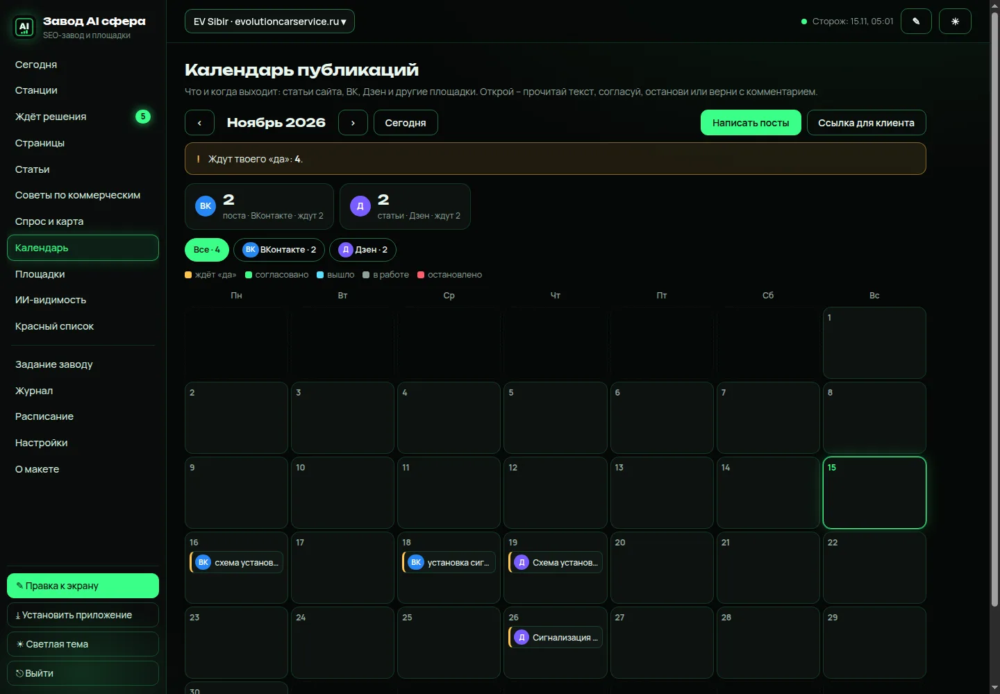
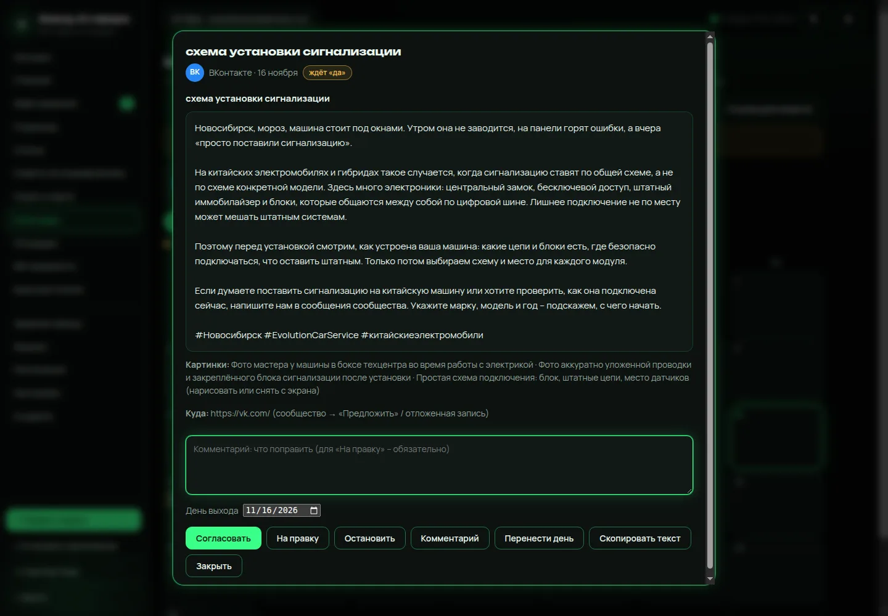
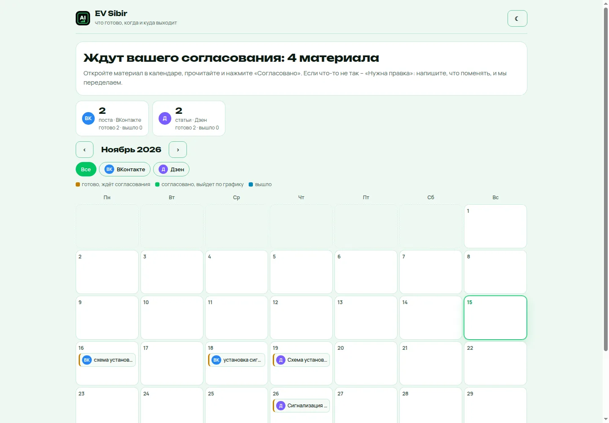
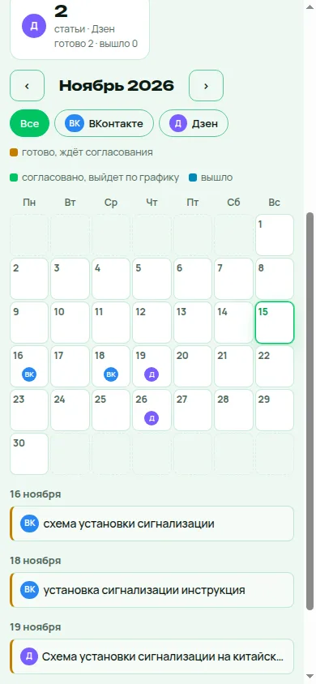

# Завод: посты ВК и Дзена, календарь публикаций и кабинет клиента

Завод теперь пишет посты для ВК и Дзена и раскладывает их по календарю. Ты открываешь пост, читаешь и решаешь: согласовать, остановить или вернуть с комментарием. Клиенту уходит отдельная ссылка: он видит только готовое – сколько, когда и куда выходит, – и может открыть любой пост целиком.

## 1. Посты пишутся уже сейчас, без статьи на сайте
- Новая станция «Посты»: ты даёшь темы или берёшь их из очереди карты спроса, Claude пишет пост под каждую площадку – короткий для ВК, длинный для Дзена.
- Каждый пост проходит ту же проверку, что и статьи: факты сайта, красный список, правила площадки. Не прошёл – одна правка автором, не помогло – остаётся черновиком с причиной.
- Готовое ждёт твоего «да» и встаёт в календарь на свободный день: ВК – пн, ср, пт; Дзен – чт; статьи сайта – вт и пт. График меняется в настройках сайта.
- Вживую на EV Sibir: 4 поста за 2 минуты 16 секунд, все прошли проверку и ждут «да». Цен и сроков в них нет – база фактов EV ещё не согласована, проверка не пропускает числа без фактов.

## 2. Календарь – твой пульт по выходу

- Месяц, в каждом дне – значок канала (ВК, Д – Дзен, С – сайт, IG, TG и другие) и заголовок. Цвет полоски: жёлтый – ждёт «да», зелёный – согласовано, голубой – вышло, серый – в работе, красный – остановлено.
- Сверху – сколько всего по каждому каналу и сколько ждут тебя; фильтр по каналу.
- Нажал – открылась карточка: весь текст, какие картинки нужны, куда выкладывать.

- Кнопки: **Согласовать**, **На правку** (пишешь комментарий – завод сам ставит задачу и переписывает тот же пост), **Остановить**, **Комментарий**, **Перенести день**, **Скопировать текст**.
- «Да» в календаре и «да» в «Ждёт решения» – одно и то же решение. Двух разных согласований не бывает.
- Кнопка «Написать посты» – выбрать ВК и Дзен, вписать темы или взять из очереди.

## 3. Клиенту – отдельная страница без внутрянки

- Как у Баланса в старом заводе: сколько каких материалов, когда и куда выходят, и каждый открывается целиком.
- Проверки, причины, твои комментарии и остановленное клиент не видит. Вход ему не нужен – ссылка с ключом, кнопка «Ссылка для клиента» в календаре. Новая ссылка отключает старую, есть «Отключить».
- Клиент может нажать «Согласовано» или «Нужна правка» с текстом – тебе придёт отметка (✓ или ✎ на посте в календаре). Выходит всё только после твоего «да».
- На телефоне в сетке – значки, под ней список по дням.

## Проверено
- 466 тестов, все зелёные. Отдельно: клиент не видит внутрянку и чужой сайт, без ключа – 401, ключ клиента не открывает окно владельца.
- Независимый ревизор нашёл 3 серьёзных дефекта – главный: при двух открытых окнах можно было получить «согласовано» без «да». Все исправлены, на каждый – тест. Правило записано в стандарт кабинетов для всех проектов.
- Глазами в браузере: окно на компьютере, страница клиента на компьютере и на телефоне 390 px – без горизонтальной прокрутки, тема днём светлая, вечером тёмная.
- На сайты и площадки ничего не выложено.

## Нужно от тебя
- Прочитать 4 поста в календаре и решить по каждому.
- Ссылку сообщества ВК для «написать в сообщения» – сейчас в постах ВК её нет.
- «Да» на базу фактов EV – тогда в постах и статьях появятся цены и сроки.
- Instagram и Telegram – значки в календаре есть, писать под них пока не умеем. Сказать, какой следующий.

## Что раскрыть
- Как завод выбирает день и как поменять график.
- Что видит клиент, а что нет – по полям.
- Тексты всех 4 постов.
